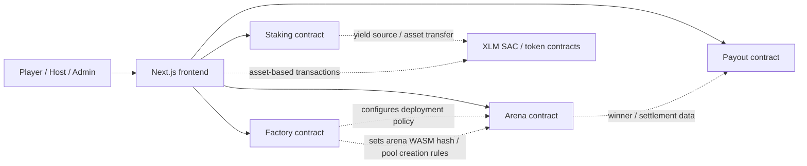
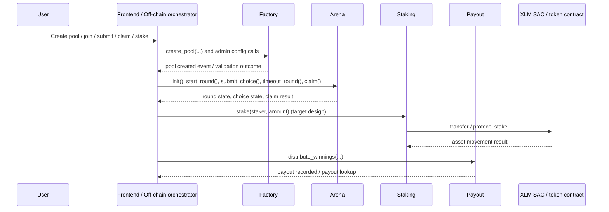
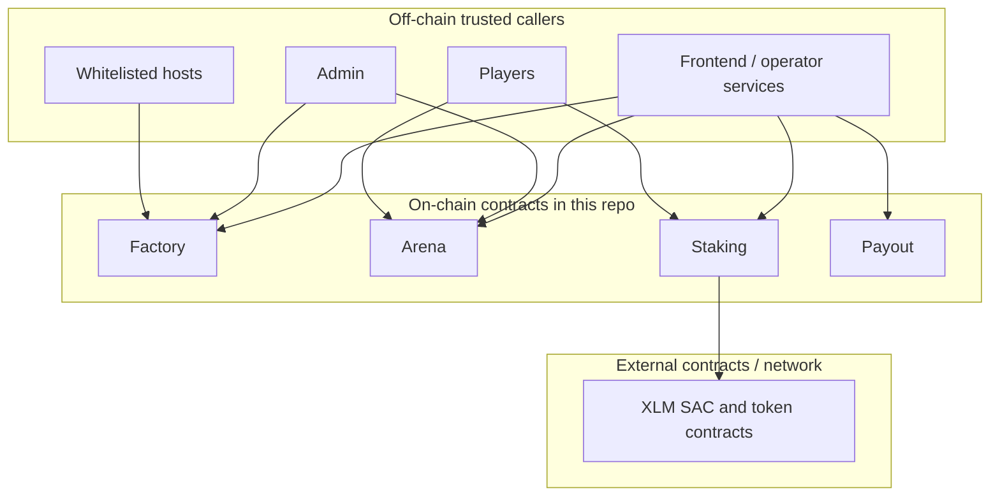

# Inverse Arena Contract Architecture

> **RWA Yield Flow:** For a complete end-to-end explanation of how entry fees are converted to USDY, how yield accrues, and how the winner's payout is calculated, see [docs/RWA_YIELD_FLOW.md](../docs/RWA_YIELD_FLOW.md).

This document describes how the Soroban contracts in `contract/` fit together, which components trust each other, and where authority lives today.

It is meant to help:
- contributors understand the end-to-end contract flow
- reviewers reason about security boundaries
- frontend and backend developers map client calls to on-chain entrypoints

## Contract Inventory

| Contract | Primary role | Current responsibility |
| --- | --- | --- |
| `factory` | Pool creation and protocol administration | Maintains admin state, host whitelist, arena WASM hash, minimum stake rules, and emits pool creation events |
| `arena` | Round lifecycle and game state | Stores round configuration, player submissions, timeout state, pause flag, admin controls, and upgrade timelock |
| `staking` | Protocol staking | Intended to accept XLM staking deposits and track staker shares; currently still minimal in this repo |
| `payout` | Winnings distribution | Records idempotent payout executions and exposes payout lookup helpers |
| External token contracts | Asset movement | XLM SAC and token contracts used by frontend transaction builders for stake and pool-related flows |

## System Overview

## Inter-Contract Call Diagram

The current codebase is still early-stage: the contracts are mostly coordinated by off-chain callers rather than making many direct cross-contract invocations. The key interaction pattern is therefore orchestrated flow, not deep contract-to-contract execution.

## Data Flow

1. A host or admin uses the `factory` contract to set deployment parameters and create a pool.
2. The frontend treats the resulting arena as the primary gameplay contract and calls `arena` entrypoints for round progression.
3. Players submit choices to `arena`, which stores per-round submissions in persistent storage.
4. After a winner is known, payout handling is expected to move through `payout`, which records idempotent payout execution.
5. Staking-related user flows are expected to route through `staking`, which in turn interacts with XLM or other Stellar asset contracts.

## Trust Boundaries

Trust notes:
- `factory`, `arena`, `staking`, and `payout` are separate contracts with separate storage domains.
- The frontend is a coordinator and must not be treated as an authority boundary by itself; each contract must still enforce auth and state rules on-chain.
- External token contracts are outside this repository and should be treated as integration dependencies, not internal trusted logic.
- Cross-contract assumptions should stay narrow: emit data and persist state explicitly instead of assuming shared storage or implicit trust.

## Ownership And Upgrade Authority

### Factory

- Uses an `ADMIN` instance key.
- The admin can:
  - change admin
  - set the arena WASM hash
  - manage the host whitelist
  - update minimum stake rules
  - propose, execute, and cancel upgrades through the timelock flow

### Arena

- Has a separate `ADMIN` instance key from the factory. It is the arena's
  **host** role, and it is stored in `ArenaConfig.admin` — the field keeps its
  original name so the stored layout of every already-deployed arena stays
  readable.
- The **host** can:
  - hand the role on (`propose_admin` / `accept_admin`, with the alias
    `change_admin`)
  - configure the lobby (`configure_player_limits`, `configure_leaderboard_limit`)
  - moderate the lobby (`ban_player`, `unban_player`)
  - cancel an arena that has not started (`cancel_arena`)
  - run the game (`start_round`, `start_next_round`, `resolve_round`)
- The **protocol admin** can:
  - propose, execute, and cancel upgrades
  - set the platform fee
  - set the oracle freshness policy
  - pause and unpause the contract
  - force-cancel a started arena (`force_cancel_arena`)
- The protocol admin is **not** a separate key on the arena: the arena reads
  the deploying factory's current admin (`factory.admin()`) at the moment the
  authority is exercised. A factory-level admin rotation
  (`factory.propose_admin` / `factory.accept_admin`) therefore withdraws the
  old admin's powers over every arena at once, with no per-arena bookkeeping.
  An arena whose factory cannot answer has no protocol admin, and its
  protocol-only entry points fail with `ArenaError::NoProtocolAdmin` rather
  than falling back to the host.
- A pause is **time-boxed**: it stops blocking after
  `MAX_PAUSE_DURATION_SECONDS` (24 h). A protocol pause can therefore never
  hold an arena — or the entry fees in it — shut indefinitely, and
  `pause_expired` reports when the bound has been reached. A pause recorded
  before the role split carries no timestamp and is treated as already
  expired, so an unbounded legacy pause cannot lock player funds.
- Gameplay entrypoints like `start_round` and `timeout_round` are intentionally callable by non-admin actors, but still guarded by contract state.

### Host inactivity liveness

An active round remains host-controlled until its configured deadline plus
`HOST_GRACE_SECONDS` (one hour). After that point, `resolve_round` is
permissionless. Between rounds, `start_next_round(caller)` is permissionless
after the same grace period and reuses the stored round duration. Both keeper
paths remain blocked while the arena is paused, and transition events identify
host versus keeper initiation. This lets a live arena reach its normal winner
state even if its host disappears.

### Payout

- Has its own admin key.
- Winnings distribution is controlled by admin-gated payout execution.

### Staking

- The current contract is still a placeholder, so its final ownership model is not fully implemented yet.
- Based on the architecture direction, it should define admin or operator authority explicitly before handling real funds.

## Authority Model Summary

### Arena role matrix (#1629)

| Capability | Factory admin (= arena protocol admin) | Arena host | Player | Anyone |
| --- | --- | --- | --- | --- |
| Set or rotate the host role | No | Yes | No | No |
| Configure the lobby (player limits, leaderboard limit) | No | Yes | No | No |
| Moderate the lobby (ban / unban) | No | Yes | No | No |
| Cancel an unstarted arena | No | Yes | No | No |
| Start a round | No | Yes | No | No |
| Start the next round after the host missed the grace period | No | No | No | Yes (self-authorised caller) |
| Resolve a round | No | Yes (or a keeper after the grace period) | No | Yes, after the grace period |
| Upgrade the arena WASM | Yes | No | No | No |
| Set the platform fee | Yes | No | No | No |
| Set the oracle freshness policy | Yes | No | No | No |
| Pause / unpause the arena | Yes | No | No | No |
| Force-cancel a started arena | Yes | No | No | No |
| Join, commit, reveal | No | No | Yes | No |
| Claim a prize or refund | No | No | Yes | No |

### Other contracts

| Capability | Factory admin | Arena host | Payout admin | Player | Whitelisted host |
| --- | --- | --- | --- | --- | --- |
| Set or rotate admin | Yes | Yes | Yes | No | No |
| Upgrade contract | Yes | No | Not implemented yet | No | No |
| Create pool | Yes | No | No | No | Yes |
| Start or timeout round | No | No special admin requirement | No | Yes, if rules allow | Yes, if rules allow |
| Submit round choice | No | No | No | Yes | No |
| Distribute winnings | No | No | Yes | No | No |
| Stake XLM | No | No | No | Yes | No |

## Security Review Notes

- The contracts do not currently form a single centralized permission layer; each contract carries its own admin state and must be reviewed independently.
- Upgrade authority is decentralized by contract, which reduces blast radius but increases operational coordination needs.
- The most important trust assumptions are:
  - admin keys are securely managed
  - frontend callers pass the correct contract IDs
  - token contract integrations use the expected Stellar asset contract
- Because some flows are still stubbed or partially implemented, reviewers should distinguish between:
  - current on-chain guarantees already present in code
  - intended future interactions described here for system understanding

### Settlement security (#1627, #1630, #1631)

- **Expiry griefing (#1627).** `expire_arena` opens only after
  `commit_deadline + EXPIRY_GRACE_SECONDS` (86,400 s). The commit deadline is
  also when reveals open and `resolve_round` becomes callable, so an earlier
  gate would let any account cancel the game before reveals or resolution. The
  grace period sits well above `HOST_GRACE_SECONDS`, so a keeper-initiated
  resolution cannot race a stranger's expiry.
- **Commitment binding (#1630).** The commitment is
  `SHA-256("IA_COMMIT_V1" || arena || round || player || choice || salt)`, where
  `arena` and `player` are the ScVal XDR of each address and `round` is `u32`
  big-endian. A hash copied from another player, arena, or round fails
  `reveal_choice` with `InvalidReveal`. The layout is shared with the frontend
  through `contract/test-vectors/commitment.json`.
  - *Migration:* the preimage changed, so a commitment made under the old
    layout cannot be revealed after upgrade. Upgrade only while no arena has an
    open commit phase, or accept that those players are eliminated as
    non-revealers for that round.
- **Fail-closed vault withdrawals (#1631).** Every settlement path (cancel,
  force-cancel, expiry, zero-survivor resolution, claim) pulls principal through
  one helper. `claim` pays exactly the balance delta the withdrawal delivered,
  and reverts with `VaultWithdrawFailed` if the vault refuses. A cancellation
  that cannot withdraw still completes, but sets `funds_in_vault`, which blocks
  `claim_refund` with `FundsInVault`. `retry_withdraw` is permissionless and
  idempotent, and clears the flag once the vault releases the principal.

## Implementation Status Note

This architecture document reflects the current repository structure as of the contracts present in `contract/`. Some described flows, especially staking and deeper payout orchestration, are target architecture and are not yet fully implemented on-chain.
